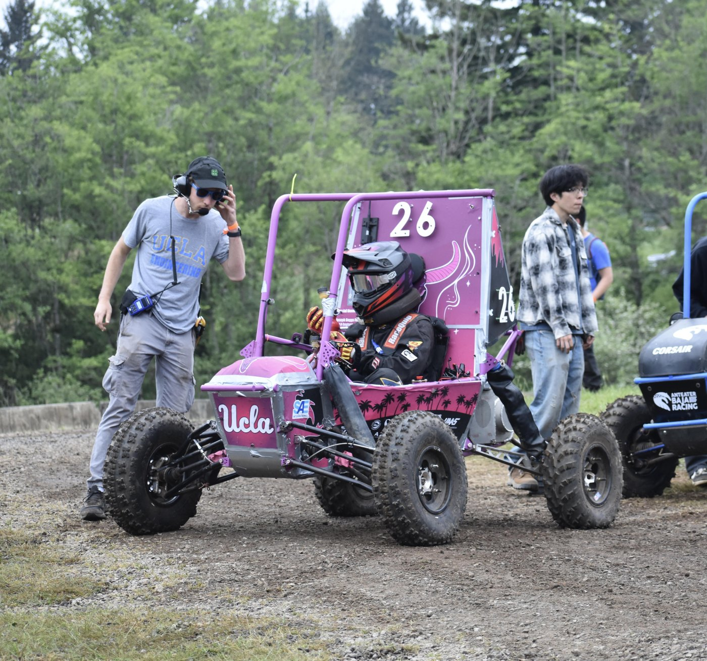
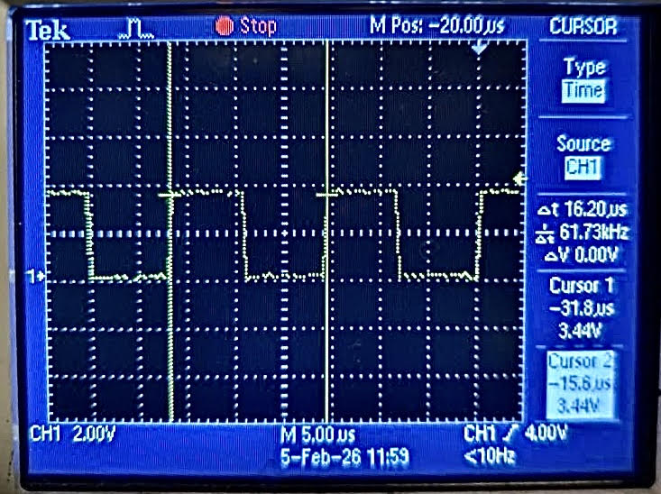
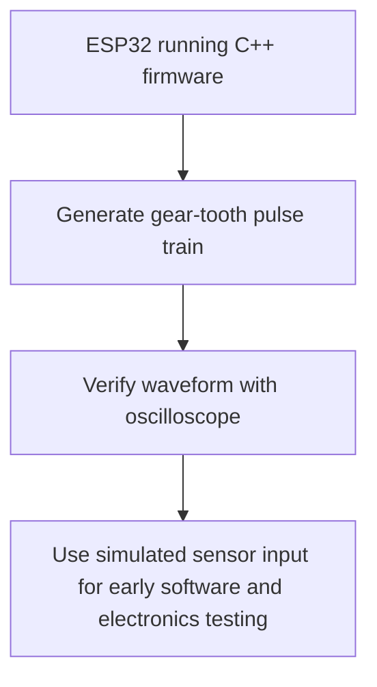
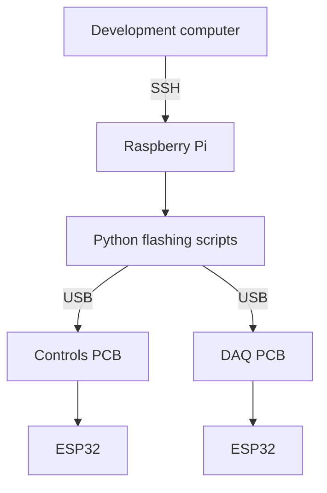

# Embedded Software & Vehicle Data Acquisition — UCLA Bruin Racing Baja

**ESP32 firmware · Hardware-in-the-loop testing · Vehicle data acquisition · Embedded deployment**

I contribute to the software and electronics work for **UCLA Bruin Racing Baja**, the team's off-road vehicle project. My work has included ESP32 firmware for gear-tooth sensor simulation, vehicle data-acquisition work, and firmware deployment to the vehicle's embedded boards.

This repository is a **technical project overview**. It documents selected contributions and engineering context; it does not contain team-owned source code or internal implementation files.

> **My role:** Software Project Engineer, UCLA Bruin Racing Baja  
> **Focus:** Embedded firmware, test infrastructure, data acquisition, deployment, and debugging

*UCLA Bruin Racing Baja vehicle.*

---

## Project at a glance

| Area | My contribution | Technologies |
|---|---|---|
| Hardware-in-the-loop (HIL) | ESP32 firmware to generate gear-tooth sensor pulses for engine-speed simulation | C++, ESP32 |
| Signal validation | Verified generated pulse signals with an oscilloscope | Oscilloscope, embedded debugging |
| Vehicle data acquisition | Contributed to parsing GPS, IMU, and motor-speed telemetry and working with vehicle sensor data | SPI, UART, CAN, embedded firmware |
| Firmware deployment | Developed Python scripts running on a Raspberry Pi to independently flash firmware to the Controls and DAQ board ESP32s | Python, Raspberry Pi, USB, SSH, ESP32 |

## 1. Hardware-in-the-loop sensor simulation

I developed ESP32 C++ firmware for a hardware-in-the-loop test setup that simulated a gear-tooth sensor signal. The firmware generated pulse trains representing engine-speed input, with simulation up to **4,000 RPM**.

I used an oscilloscope to verify the generated signal. This enabled software and electronics testing approximately **three months before the vehicle hardware was ready**, allowing parts of the system to be exercised earlier in the build cycle.

### Oscilloscope validation

*Oscilloscope capture from one HIL signal-validation run. The cursor measurement shows a period of 16.20 μs (61.73 kHz). This captured frequency is not being presented as the 4,000 RPM operating point; conversion to engine speed depends on the configured pulses per revolution.*

### Signal-generation and validation flow

*Conceptual workflow; this diagram is not an electrical schematic or a representation of exact team wiring.*

### What I worked on

- Implemented ESP32 firmware to generate gear-tooth sensor pulses.
- Supported engine-speed simulation up to 4,000 RPM.
- Checked the generated waveform using an oscilloscope.
- Enabled earlier software and electronics testing before the physical vehicle hardware was available.

## 2. Vehicle data acquisition

I contributed to the vehicle data-acquisition work, including parsing **GPS, IMU, and motor-speed telemetry** over **SPI/UART/CAN**. The DAQ work also involved sensor data from **shock potentiometers** and **brake-pressure sensors**.

My work in this area involved the embedded data path and parsing of vehicle signals. This overview intentionally stays at the functional level rather than publishing internal wiring details, message formats, raw logs, or team implementation files.

### Areas of contribution

- Contributed to parsing GPS, IMU, and motor-speed telemetry.
- Worked with SPI, UART, and CAN communication in the DAQ system.
- Worked with vehicle sensor data.

## 3. Embedded firmware deployment and automation

I developed Python scripts for a Raspberry Pi-based firmware deployment workflow. The development computer accessed the Raspberry Pi remotely over **SSH**, while the Raspberry Pi connected over **USB** to two separate PCBs:

- **Controls board:** Contains one ESP32.
- **DAQ board:** Contains one ESP32.

The Python scripts running on the Raspberry Pi automated firmware flashing to each ESP32 independently, providing a centralized way to deploy firmware to both embedded controllers without directly connecting the development computer to each board.

### Deployment architecture

*Conceptual deployment architecture showing the Raspberry Pi-based Python workflow and the two independently programmable ESP32 targets. This does not represent the exact internal implementation of the deployment scripts.*

This work involved developing deployment automation for a multi-controller embedded system, combining Python scripting, remote Linux-based execution, USB-connected hardware, and ESP32 firmware flashing.

## Engineering tools and interfaces

- **Languages:** C++, Python
- **Microcontrollers:** ESP32 (Controls and DAQ boards)
- **Embedded platform:** Raspberry Pi
- **Communication and deployment:** SPI, UART, CAN, USB, SSH
- **Testing and debugging:** Oscilloscope, firmware validation, hardware/software troubleshooting

## Scope and disclosure

This repository is a portfolio write-up of my individual contributions to a larger team project. It intentionally excludes team-owned source code, private repositories, internal documentation, credentials, raw logs, proprietary designs, and unapproved engineering details. Diagrams are explanatory summaries, not released engineering drawings.

---

*UCLA Bruin Racing Baja · Embedded Software & Electronics*
